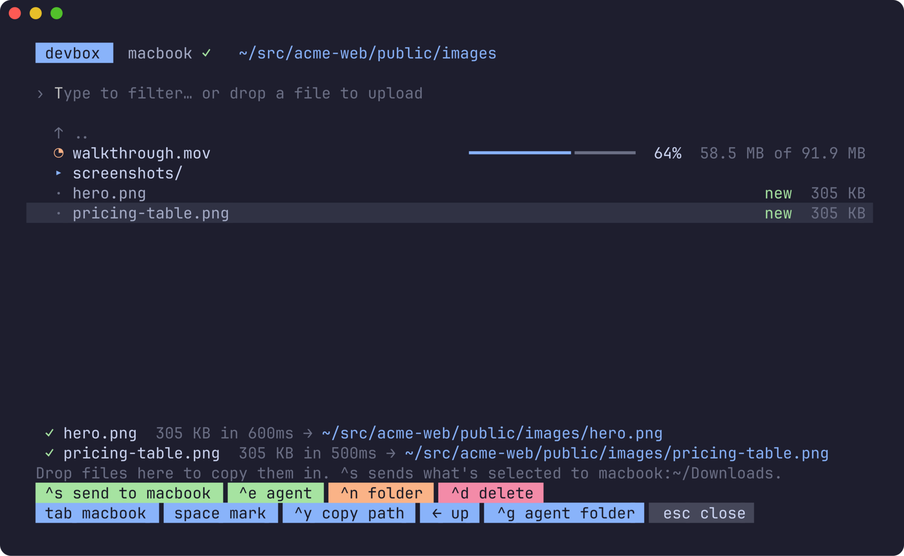
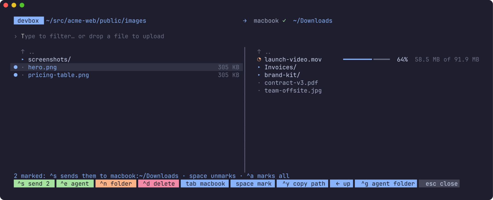
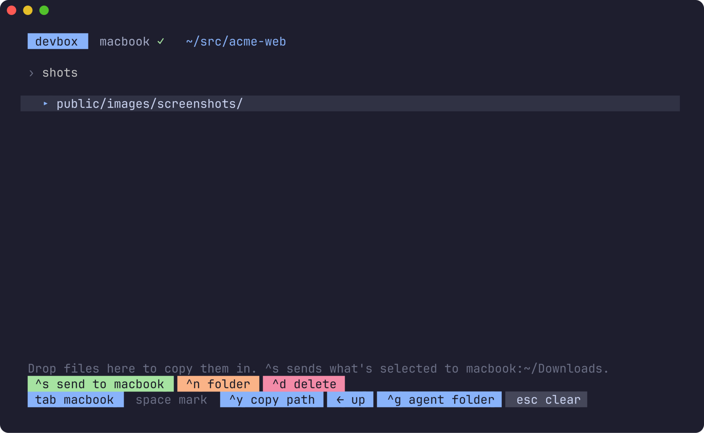
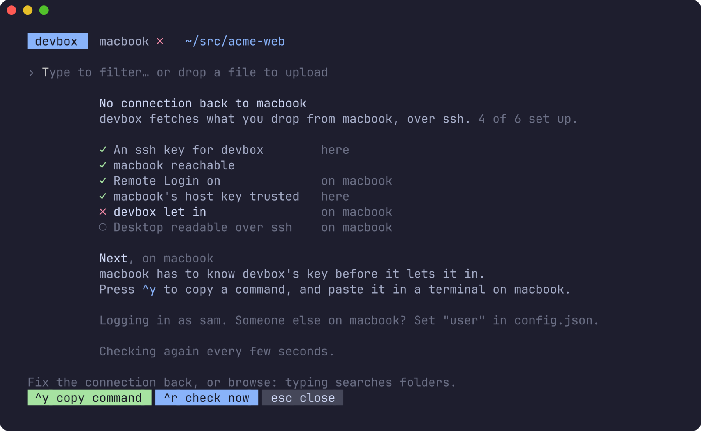
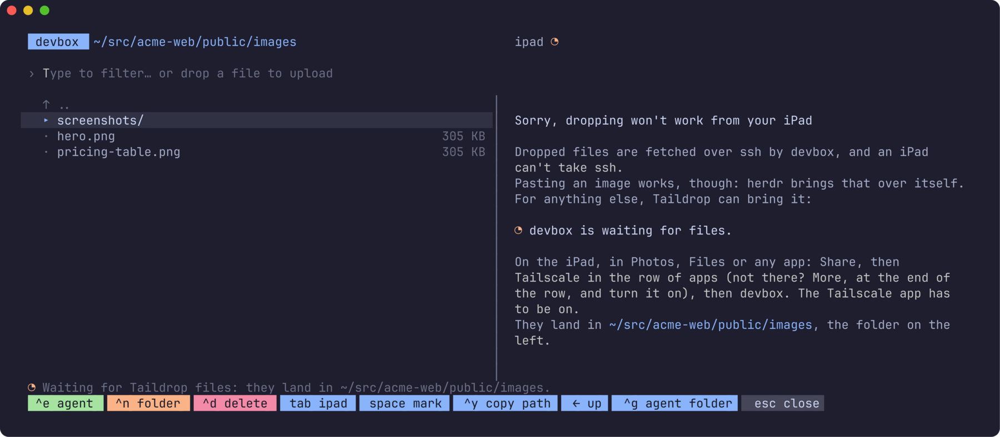

# herdr-file-transfer

**Drop a file on herdr, and it's in your agent's folder.**

Running herdr on a VPS or a remote box (Hetzner, a cloud dev server), and
getting files to it is a pain: the screenshot, the PDF, the CSV you want an
agent to look at is on your laptop. herdr-file-transfer is a
[herdr](https://herdr.dev) plugin that opens a popup on the folder of the
agent you're in: drop files on it from Finder or your desktop, and they're
copied there, over ssh, from the machine you're at.

> Assumes the two machines can reach each other over ssh, for example both
> on [Tailscale](https://tailscale.com). If the way back from the server to
> yours isn't set up yet, the popup [walks you through it](#the-way-back).



- **Drop, done.** Your terminal pastes a dropped file's path; the popup
  fetches it from your machine and puts it in the folder it shows. Several
  files at once, and whole folders.
- **Anywhere you like.** It opens on the agent's folder; browse to another
  (`enter` in, `←` out), or type to search every folder under it. `^n`
  makes a new one.
- **Both machines, side by side.** The server's folders on the left, those
  of the machine you're at on the right (found from the herdr client you
  pressed the key on, called by its Tailscale name). `tab` moves between
  them. In a narrower popup they're tabs instead, with the same keys.


- **It tells you what's missing.** The popup checks the way back to your
  machine as it opens, and if something's not set up, says what, and how,
  with a key for what it can do itself.
- **From an iPad or a phone**, which can't take ssh, it says so, and takes
  files sent with Taildrop instead.
- **Progress as it comes.** A file shows up in its folder the moment it's
  dropped, with a spinner and a bar, and is the real thing once whole.
- **Images just work.** An image you drop or paste is brought over by
  herdr itself; it's put in the folder as `image-<when>.png`, no ssh needed.
- **Either way, several at once.** `space` marks files (`^a` all of them);
  `^s send 2 to macbook-pro` sends them into the folder shown on the other
  side: from the server to your machine, or from it to the server.
- **Straight to the agent.** `^e` types the selected file's path into the
  agent you opened it from, ready for your prompt; `^y` copies the path.
- **Nothing overwritten.** A name that's taken gets the next free one
  (`hero 2.png`). `^d` moves a file to the trash, after asking.
- **It fits in.** Follows herdr's theme, works with the mouse, and draws a
  key, a folder and a state the way the other herdr plugins do.

## Requirements

- **herdr 0.9.0** or later, on **Linux** or **macOS**.
- **ssh from the server back to your machine.** You already have the way
  *in* (it's how you reached herdr); this needs the way *back*. See
  [The way back](#the-way-back): the popup walks you through it.
- `tar` on both ends (every Mac and Linux has it).

## Install

```sh
herdr plugin install mrolafsson/herdr-file-transfer
```

The build step compiles it with Go if you have it, or downloads the release
binary for your platform and checks its SHA-256.

Then bind a key in `~/.config/herdr/config.toml`:

```toml
[[keys.command]]
key = "prefix+alt+f"
type = "plugin_action"
command = "herdr-file-transfer.open"
description = "file transfer: drop files here"
```

On macOS, `alt` needs Option to send Alt in your terminal (Ghostty:
`macos-option-as-alt = true`). Then `herdr server reload-config`, and start a
new herdr client: one that was already open keeps the bindings it started
with.

### From a local checkout

```sh
git clone https://github.com/mrolafsson/herdr-file-transfer
herdr plugin link ./herdr-file-transfer
```

After editing the code, `go build -o bin/herdr-file-transfer .`.

## Use

`prefix+alt+f`, and drop. Each pane's title is its machine and the folder
it shows, the one the keys go to highlighted; the arrow over the divider is
the way `^s` sends, and the ✓ by your machine says the way back works.



| Key | |
| --- | --- |
| type | search this folder and the ones under it |
| `enter` / `→` | into the folder (on no match: make it) |
| `←` / `backspace` | up a folder |
| `^n` | new folder here (`a/b` makes both) |
| `^s` | send what's marked (or selected) into the folder shown on the other side |
| `^e` | type the marked (or selected) paths into the agent, and close |
| `^y` | copy the marked (or selected) paths |
| `^d` | move what's marked (or selected) to the trash, after a `y` |
| `^g` | back to the agent folder (on your machine's side: Downloads) |
| `tab` | the other machine's pane (or tab): the server's, or yours |
| `space` | mark or unmark, and move on; `^a` marks all, or none |
| `^r` | check the way back now |
| `esc` | clear the search, or close |

Closing the popup stops a copy under way; `esc` asks first.

## The way back

Files are fetched *by the server*, so the server has to be able to ssh to
your machine: the other way round from how you reached it. On a Mac, five
things, in the order ssh meets them:

1. **The server has an ssh key.** `^k` in the popup makes one
   (`~/.ssh/id_ed25519`), or `ssh-keygen -t ed25519` there.
2. **Your Mac takes ssh.** *System Settings › General › Sharing › Remote
   Login*, on.
3. **The server knows your Mac's host key.** `^a` in the popup trusts the
   one it shows now, or `ssh you@your-mac` once from the server and answer
   *yes*.
4. **Your Mac lets the server in.** `^y` in the popup copies a command to
   your clipboard; paste it in a terminal on the Mac. It adds the server's
   key to `~/.ssh/authorized_keys` there.
5. **ssh may read Desktop, Documents and Downloads.** macOS keeps those from
   Remote Login until *System Settings › General › Sharing*, the (i) by
   *Remote Login*, *Allow full disk access for remote users*, is on.

You needn't remember any of it: when something's missing, the popup gives
itself over to this list, ticks what works, and under **Next** says the one thing to do
now, where (here, or on your Mac), and how; its key is the green one along
the bottom. It checks again every few seconds, so each step ticks itself
as you do it, and once all are done it's straight back to your folder.



*File transfer: demo (connection setup)* in the command palette shows it on
a made-up Mac, without ssh: to see what it looks like, or to screenshot.

From the command line, `herdr-file-transfer check` does the same for every
machine attached:

```
✓ macbook (sam@macbook): ready
✗ studio (studio): studio's host key isn't known here: ssh studio once by hand
```

On **Linux**, step 2 is `openssh-server` and `sudo systemctl enable --now
ssh`; step 5 doesn't apply. On **Windows**, step 2 is *Settings › System ›
Optional features › OpenSSH Server*, then start the `sshd` service.

**With Tailscale**, machines are reached by their MagicDNS name, and if your
tailnet allows [Tailscale SSH](https://tailscale.com/kb/1193/tailscale-ssh)
to your machine, steps 1, 3 and 4 are taken care of.

**Who you log in as.** The owner of the dropped path (`/Users/sam/…` is
sam), else whoever a drop last got in as on that machine, else the server's
own user name. Set `user` in `config.json` if you're someone else there.

### From an iPad or a phone

They can't take ssh, so dropping can't work from them, and the popup says
so, in the pane beside the server's folders. Taildrop can still bring
files: the server waits for them as soon as the popup opens, into the
folder shown; browse to the one you want, share them from the iPad, and
they land there. Taildrop has
no screen of its own on an iPad: it's Tailscale in the share sheet. Tap
*Share*, then *Tailscale* in the row of apps (not there? *More*, at the end
of that row, and turn it on), then the server. The Tailscale app has to be
installed and on.



Taildrop on a Linux server only hands files to root or Tailscale's
operator. If the popup says so, once: `sudo tailscale set --operator=$USER`
(`^y` copies it).

## Configuration

`config.json` in `herdr plugin config-dir herdr-file-transfer`:

```json
{
  "sender": "",
  "user": "",
  "show_hidden": false,
  "search_depth": 6,
  "theme": ""
}
```

- `sender`: an ssh target to always fetch from (`me@laptop`, or a `Host`
  from `~/.ssh/config`), ahead of the ones found.
- `user`: who to log in as on a found machine.
- `show_hidden`: list dot-files and dot-folders.
- `search_depth`: how many folders down search looks.
- `theme`: `dark` or `light`, if the terminal can't say.

`herdr-file-transfer senders` lists the machines as the popup finds them,
the likeliest first.

## How it works

herdr's popups receive pastes, and a terminal pastes a dropped file's path.
The popup runs on the server, where that path doesn't exist, so it asks the
machine it came from: `ssh you@machine tar -c <file>`, unpacked here into a
hidden folder next to where it's going, then moved into place.

The machines are found from the `SSH_CONNECTION` of each herdr client
process (a mosh client keeps its bootstrap ssh's), named from `tailscale
status`. The one you're at is the one whose terminal just had a key pressed
(the key that opened the popup); a `herdr --remote` client, which reads a
pipe and can't say, comes next. On a macOS server, which can't read another
process's environment, it's `sender`, or the server's own.

When herdr runs on the machine you're at (no ssh), files are copied locally.

## Development

```sh
go test ./...
sh scripts/screenshots.sh    # docs/images from a made-up project (needs freeze)
```

## License

MIT
